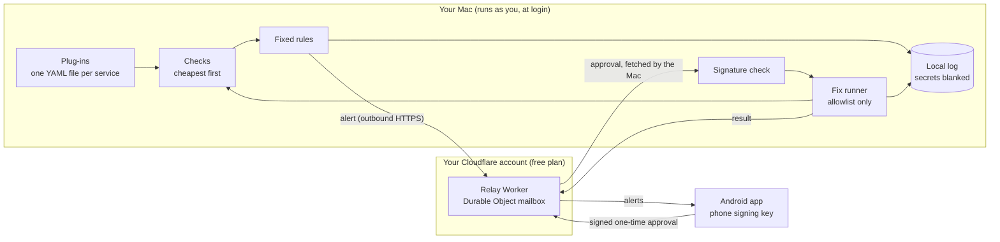
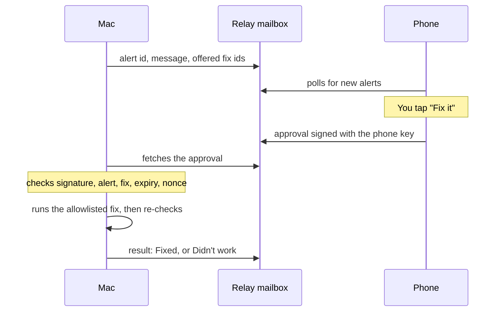

# Daemon Doctor

[](https://github.com/ZeroCool0388/daemon-doctor/actions/workflows/ci.yml)

**A small watchdog for the apps and background services on your Mac.** It notices when one is down, stuck, or hogging the machine, tells your phone in plain English, and fixes it only after you tap "Fix it" and the Mac has checked your phone's signature.

- Fixed, readable rules decide every alert. Fixes come only from an allowlist you write.
- The Mac only makes outbound connections. Nothing on the internet can connect in.
- The relay is a mailbox on your own free Cloudflare account. It cannot run anything on your Mac.
- One Go binary, one YAML file per watched service, an Android app you sideload. Built to run on free tiers.

## The problem

An always-on Mac that runs helper apps (sync tools, mail bridges, local gateways, scheduled jobs) fails quietly. An app can look open but have stopped making progress. The Mac never slept and the network was fine, yet the app stopped answering. You find out hours later, when you need it, and then you work out the cause by hand from process lists, power logs and network status.

Daemon Doctor does that checking on a timer, explains what it found, and offers the fix you already approved for that app.

## Who it's for

People who keep a Mac running helper apps and want:

- a plain-English notice on their phone when one of them is down, stuck, or holding the CPU or memory;
- a one-tap fix that is limited to actions they listed in that app's plug-in file;
- no inbound ports, no root, no third-party service that can act on the machine.

## Demo

The terminal recording [docs/demo.cast](docs/demo.cast) is the real output of `daemon-doctor demo`. Play it with `asciinema play docs/demo.cast`. Its first scene:

```
Daemon Doctor demo
Fake services. No Mac, no relay, and no phone.

Scene 1. Example Desktop App is stuck, then force-restarted.
12:04 UTC  alert: Example Desktop App is open but has no established outbound connection on port 443, so it looks stuck.
12:04 UTC  fix offered: force-restart
12:04 UTC  outcome: Fixed. Example Desktop App looks healthy on recheck.
```

## Try the replay yourself

Demo mode runs fake services and scripted incidents. It needs no Mac, no config file, no account, no keys and no network. It runs the same way in CI.

```
git clone https://github.com/ZeroCool0388/daemon-doctor.git
cd daemon-doctor
go build -o daemon-doctor ./cmd/daemon-doctor
./daemon-doctor demo
```

It replays four incidents:

1. An app that is running but stuck, then force-restarted and confirmed healthy.
2. A network drop. Other alerts pause, and when the network returns one summary names the only service that stayed down.
3. An unwatched process holding 90% of the CPU for 5 minutes. Only `stop` is offered.
4. A service that fails three times in an hour, after which fixes are no longer offered.

The scripted clock jumps forward, so the 5-minute CPU rule finishes without waiting.

The Android app has its own demo mode, on by default, with built-in fictional alerts. It does not call a relay.

## Architecture



- **Mac program** (`cmd/`, `internal/`). Go, one binary, runs as the normal user from a LaunchAgent. It reads processes, outbound TCP connections, launchd job results, file ages and host readings, applies fixed rules, writes a local JSON-lines log, and talks to the relay over outbound HTTPS and an outbound WebSocket.
- **Relay** (`relay/`). A Cloudflare Worker with one SQLite-backed Durable Object per Mac id. It stores and forwards small JSON messages in four boxes: `pairing`, `alerts`, `approvals` and `results`. It does not check signatures and it has no route that runs a command.
- **Android app** (`android/`). Kotlin and Jetpack Compose. It shows alerts, a status row per service and alert history, and signs approvals with a key that never leaves the phone.

### What it watches

Each watched service is a YAML plug-in in `plugins/`. Adding a service means adding a file, not code:

```yaml
id: syncthing
name: Syncthing
process:
  match: syncthing
checks:
  - type: process_running
messages:
  down: "Syncthing has stopped. It is not running."
  keeps_happening: "Syncthing has failed 3 times in the last hour. Automatic fixes are paused."
fixes:
  stop:
    kind: stop
  restart:
    kind: restart
  force-restart:
    kind: force-restart
```

A plug-in selects a process by exact name or path, a command-line substring, or a regular expression, and lists its checks cheapest first:

| Check | Fails when |
|---|---|
| `process_running` | The process is not running. |
| `outbound_tcp` | The process tree has no established outbound connection for N checks in a row. |
| `file_recent` | A heartbeat or log file is missing or older than `max_age`. |
| `launched_with_flags` | The command line is missing a required flag. |
| `launchd_job` | A scheduled launchd job last exited non-zero, or has not run on time. |

`plugins/this-mac.yaml` covers the machine itself: sleep and wake, network, free disk space, memory pressure and CPU. The repo also ships plug-ins for several common desktop apps, a local gateway, a mail bridge, Syncthing and Screen Sharing, plus a fictional `example-desktop-app`.

### Alerts

| Alert | When | Fix offered, if allowlisted |
|---|---|---|
| Down | The process is missing on 2 checks in a row. | `restart`, or `launchctl_kickstart` |
| Running but stuck | The process is up but a health check keeps failing. | `force-restart` |
| Started without its settings | A required command-line flag is missing. | `restart` |
| Scheduled job failed | A launchd job failed or did not run on time. | `launchctl_kickstart` |
| Hogging the Mac | CPU at or above 85%, or memory pressure at warning or above, for 5 minutes. Names the culprit. | Watched app: `stop` or `restart`. Anything else: `stop` only. |
| Network down | No default route. Other alerts pause, and one summary is sent when it returns. | None |
| Low disk | Free space below 10%. | None |
| Sleep or wake | The Mac changed power state. | None |
| Keeps happening | 3 failures for one service within an hour. | Fixes are paused. |

The same condition does not raise a second alert. Thresholds and durations are set in the plug-in files.

### Signed one-time approvals

Pairing swaps public keys once. After that, every fix needs a fresh signature from the paired phone:



The phone signs exactly `daemon-doctor/approval/v1`, the Mac id, the alert id, the fix id, a random one-time nonce and an expiry. The Mac accepts the approval only when:

1. the signature matches a paired phone key;
2. the alert is one this Mac raised, and the fix id is one that alert offered;
3. the expiry is in the future and no more than 10 minutes ahead (plus 1 minute of clock skew);
4. the nonce has never been used.

Anything else is refused and logged, and nothing runs. Unknown JSON fields are refused, so a command cannot ride along in the message. The fix that runs is the one stored in the local plug-in file, executed directly with no shell. `stop` and `restart` send TERM, `force-restart` sends KILL, and `launchctl_kickstart` runs `launchctl kickstart -k` for the plug-in's label. After every fix the Mac re-checks the service and reports "Fixed" or "Didn't work".

Because the Mac checks every signature itself, a relay that is taken over can delay or drop messages but cannot make the Mac run anything. The security tests include forged, replayed, expired, altered, wrong-phone and smuggled-command approvals, and a relay that tampers with messages.

## Quick start

You need a Mac, Go 1.25 or later, Node 22 for the relay, a free Cloudflare account, and an Android phone.

### 1. Install on the Mac

```
git clone https://github.com/ZeroCool0388/daemon-doctor.git
cd daemon-doctor
go build -o daemon-doctor ./cmd/daemon-doctor
mkdir -p ~/bin ~/.config/daemon-doctor/plugins
cp daemon-doctor ~/bin/
cp config.example.yaml ~/.config/daemon-doctor/config.yaml
cp plugins/this-mac.yaml plugins/syncthing.yaml ~/.config/daemon-doctor/plugins/
~/bin/daemon-doctor status
```

`plugins_dir` is resolved next to the config file. Copy only the plug-ins for apps you actually run, because a plug-in for an app that is not installed reports it as down. `status` runs one check of each plug-in and prints the result. The real config stays in `~/.config/daemon-doctor/` and never goes in the repo.

### 2. Deploy your own relay

From `relay/`, on a free Cloudflare account:

```
npm ci
npx wrangler login
npx wrangler deploy
```

Wrangler prints the Worker's `workers.dev` address. Check it answers:

```
curl https://your-relay.example.workers.dev/health
```

Then set it in `~/.config/daemon-doctor/config.yaml`:

```yaml
relay_url: https://your-relay.example.workers.dev
```

The repo holds no Cloudflare account id or API token. Wrangler uses your own login.

### 3. Install the Android app

Download the debug APK attached to the latest `v*` release on the [Releases page](https://github.com/ZeroCool0388/daemon-doctor/releases), open it on the phone, and allow the install when Android asks. To build it yourself instead, run `./gradlew :app:assembleDebug` in `android/`; the APK is `android/app/build/outputs/apk/debug/app-debug.apk`.

The app opens in demo mode. Firebase push is optional: without `google-services.json` the app polls the relay every 15 seconds while it is open.

### 4. Pair by QR

On the Mac:

```
daemon-doctor pair
```

It prints a one-time QR code in the terminal and saves a PNG copy. In the app, turn demo mode off, open the pairing screen and scan the code. With no camera, paste the pairing text the command printed. The code works once and expires after 10 minutes. When the phone registers, the terminal prints `paired` and the phone key's fingerprint. `daemon-doctor pair --list` shows the paired fingerprints later.

The QR holds the Mac id, the Mac public key, the one-time code and the relay URL. The Mac's private key stays in its state directory with mode 0600, and the phone's private key stays on the phone.

### 5. Run at login

Edit `launchd/com.example.daemon-doctor.plist`, replacing `/path/to/daemon-doctor` and `/path/to/config.yaml` with full paths, then load it as your normal user:

```
cp launchd/com.example.daemon-doctor.plist ~/Library/LaunchAgents/
launchctl bootstrap gui/$(id -u) ~/Library/LaunchAgents/com.example.daemon-doctor.plist
```

To stop it: `launchctl bootout gui/$(id -u) ~/Library/LaunchAgents/com.example.daemon-doctor.plist`. The agent never runs as root.

### Other commands

```
daemon-doctor run                      # check on the configured interval until stopped
daemon-doctor fix --service syncthing --action restart --dry-run
daemon-doctor fix --process ExampleTool --action stop --dry-run
daemon-doctor fix --approval approval.json --dry-run
```

A fix typed on the Mac asks for `y` first, unless `--yes` is set. `--dry-run` re-checks without signalling or launching anything. `fix --approval` always checks the signature, even with `--yes`.

## Test results

Run the same checks as CI:

```
gofmt -l .
go vet ./...
go test ./...
(cd relay && npm ci && npm test)
(cd android && ./gradlew :core:test :app:testDebugUnitTest :app:assembleDebug)
```

Counts below were measured on 2026-10-12 by running those commands on a Linux x86_64 machine with 4 vCPUs, at commit `e3096f9`. This README change does not touch code.

| Suite | How it was run | Result |
|---|---|---|
| Go | Go 1.25.14, `go test -count=1 -json ./...`, counted with the summary script from `.github/workflows/ci.yml` | 12 packages ok. 131 passing tests, 26 of them subtests. 0 failures. `gofmt -l .` printed nothing and `go vet ./...` passed. |
| Relay | Node v22.14.0, `npm ci && npm test` (Vitest 4.1.11) | 1 test file, 8 tests passed. |
| Android | OpenJDK 21, Gradle 8.11.1, Android SDK platform 35, `./gradlew :core:test :app:testDebugUnitTest :app:assembleDebug`, counted from the JUnit XML with the script from `.github/workflows/ci.yml` | 11 unit tests passed, 0 failures, 0 errors, 0 skipped. The debug APK built. |

The Go suite includes the replay tests behind `daemon-doctor demo`, the hostile-relay tests, and approval vectors in `testdata/approval-vectors.json` signed by both Go and the JDK and checked on both sides.

## Cost and latency

**Cost.** Nothing in this repo is deployed or billed. The Go program and the Android app are free to build. The relay is written for the Cloudflare Workers Free plan, which includes SQLite-backed Durable Objects, so it needs no paid plan. The APK is sideloaded, so there is no store fee. CI runs on GitHub Actions for a public repository. No Cloudflare bill or request volume from a real deployment has been measured yet.

**Latency.** Measured on the same machine as the tests, with Go 1.25.14:

| What | Command | Result |
|---|---|---|
| One full check cycle on the demo's healthy fake services | `go test -run '^$' -bench=BenchmarkCheckCycle -benchtime=1s -count=1 ./internal/demo` | 9,992 ns per cycle (109,916 iterations) |
| Sign one approval and run the Mac's full approval check | `go test -run '^$' -bench=BenchmarkApprovalVerify -benchtime=1s -count=1 ./internal/security` | 102,141 ns per approval (13,981 iterations) |

The check interval itself (30 seconds in `config.example.yaml`) is not included. Time from a failure to the phone, and from a tap to a finished fix, have not been measured yet.

## Limits and next steps

- The Android app has not yet been run on a physical device. Camera scanning and Android Keystore signing are untested on hardware; the unit tests use the software signer. When Ed25519 is not available in the Keystore, the app keeps a 32-byte seed in its private files instead.
- Firebase push is behind an interface with a no-network stub. Without it, alerts reach the phone only while the app is open and polling.
- The Mac posts each fix result to the relay's `results` box, but the app does not show results yet. Check the Mac's log or `daemon-doctor status` to confirm a fix.
- The relay sees the one-time pairing code. A hostile relay could substitute a phone key during that first registration. After a key is stored, forged, replayed, expired, altered and unknown-key approvals are refused.
- Alert text is not encrypted end to end, so the relay can read the short alert it stores.
- The stuck signals are outbound TCP connections, heartbeat file age, flags and launchd job results. Other signals can be added behind the same check interface.
- Restarting an app also stops its child processes. `launchctl_kickstart` does not send a separate stop first.
- On Linux, used for CI and the demo, there is no sleep signal and memory pressure is estimated from `/proc/meminfo`.
- After 3 failures in an hour, phone fixes are paused. `daemon-doctor fix` on the Mac still runs an allowlisted action when you ask it to.

Next: run the full flow against a deployed relay on a real Mac and phone, measure failure-to-phone and tap-to-fixed latency, and wire Firebase push. An iPhone app comes later.

## License

MIT. See [LICENSE](LICENSE).
