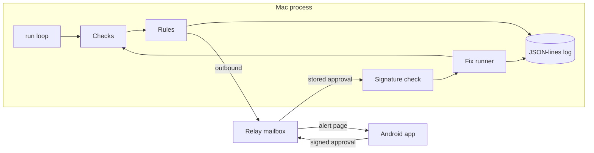

# Daemon Doctor

Watches the apps and background services on a Mac, spots when one is down, stuck, or using the machine, explains it in plain English, and fixes it only after you approve. Fixed rules only: no AI in the decision or fix path.

**Status:** Phase 5 is in the tree. See [docs/plan.md](docs/plan.md) for the full plan.

## Problem

An always-on Mac running helper apps can fail quietly. A process can still be running after it has stopped making progress, or one process can sit on the CPU or memory. Daemon Doctor checks on a timer, writes a local log, and says what it found in plain English.

## Who it's for

Someone who keeps helper apps running on a Mac and wants a local notice when one of them is down, stuck, or holding the machine, with fixes limited to an allowlist in that app's plug-in file. A paired phone can approve one of those fixes. The Mac checks the signature itself.

## Demo

A GIF is not in this repo.

The terminal recording is [docs/demo.cast](docs/demo.cast). It was made with asciinema 2.4.0 by running the built `daemon-doctor demo` command. Play it with `asciinema play docs/demo.cast`. The cast is that command's stdout. It is not a screen recording of the Android app.

## Live demo or replay

`daemon-doctor demo` replays four scripted incidents with fake services. It does not read the host, open a relay, or use a phone. The incidents are an app that is stuck and then force-restarted, a network drop and recovery that names only the service that stayed down, a CPU hog that is stopped, and a service that fails three times so fixes are no longer offered.

```
go build -o daemon-doctor ./cmd/daemon-doctor
./daemon-doctor demo
```

No config file is required. The clock in the script jumps forward so the 5-minute CPU rule finishes without waiting.

## Architecture

The Mac checks on a timer and only opens outbound connections. `relay/` is a Cloudflare Worker that stores alerts, approvals, and results for one Mac id. It uses a SQLite Durable Object as the mailbox. That is the Durable Object backend covered by the Workers free plan. The worker does not check signatures and it has no route that runs a command. It is not deployed from this repo. The Mac push hook is an interface with a no-network stub and no keys.

`android/` is a Kotlin and Jetpack Compose app. It pairs by reading the Mac's QR payload with CameraX and the on-device ML Kit barcode scanner, or by pasting that text when there is no camera. It generates an Ed25519 key in the Android Keystore when that algorithm is available, and otherwise keeps a 32-byte seed in the app's private files. It registers the public key with the relay. Alerts, a status row per service, and alert history are on screen. Fix it, Stop, Ignore, and Details use the allowlist the Mac already offered. Fix it prefers `restart`, then `force-restart`, then `launchctl_kickstart`. Stop is offered only when the alert includes `stop`. Ignore stays on the phone. A signed approval is posted only when demo mode is off. The signed text matches the Mac verifier: `daemon-doctor/approval/v1`, then `mac_id`, `alert_id`, `fix_id`, `nonce`, and `expires_unix`. `testdata/approval-vectors.json` holds one fixture produced by Go and one produced by the JDK. Go re-signs its own fixture and only verifies the JDK fixture. The Kotlin tests re-sign both.

Firebase Cloud Messaging is behind `PushHub`. The app polls the mailbox every 15 seconds while the process is running. That interval is the value in the app. `google-services.json` is gitignored. `android/google-services.json.example` is a placeholder. The debug APK builds without that file. Demo mode is the default and uses fictional alerts, so the APK does not need a relay.



Plug-ins are YAML or TOML files. A service plug-in selects a process, lists checks cheapest first, stores plain-English messages, and approves `stop`, `restart`, `force-restart`, or `launchctl_kickstart`. `process.match` is an exact process name or executable path. `process.cmd_contains` is a command-line substring, and `process.cmd_regex` is a regular expression on the command line, so a service started by `node` can match its script without the whole command. When more than one of those is set, all of them have to match. `plugins/this-mac.yaml` is the host plug-in: sleep or wake, network, free disk space, memory pressure, and CPU. It does not name a process and it has no fixes. The other shipped plug-ins are a generic AI desktop app, Codex, ChatGPT, a local gateway, Proton Mail Bridge, Syncthing, Screen Sharing, and the fictional `example-desktop-app`.

Checks read processes, established outbound TCP connections, launchd job results, file modification times, and host readings through a `Source` interface. Tests pass an in-memory source. On Linux the live source reads `/proc` and `df -P /`. On macOS it reads `ps`, `lsof`, `route`, `df`, `sysctl` or `memory_pressure`, and `pmset -g log`. The executable path comes from `ps -o comm=`, as its own column. It is not the first word of the command line, so an application path that contains spaces stays whole. A failed host command leaves that reading unknown. Unknown sleep or network does not raise an alert and does not pause anything.

Rules:

- **Down:** the process is missing on 2 checks in a row. The alert offers `restart` when that action is approved, or `launchctl_kickstart` when restart is not approved and kickstart is.
- **Running but stuck:** the process is up, and a health check has failed. The built-in health check counts established outbound TCP connections in the process tree and fails when that count stays at zero for N checks in a row. `file_recent` fails when a configured file is missing or older than `max_age`. The alert offers `force-restart` when that action is approved.
- **Started without its required settings:** `launched_with_flags` fails when the command line does not contain every configured flag. The alert says the service started without its required settings and offers `restart` when that action is approved.
- **Launchd job:** `launchd_job` is for a periodic job that exits. It fails when the last exit status is not 0 or the last run is older than `max_age`. The alert offers `launchctl_kickstart` when that action is approved.
- **Sleep or wake:** a transition raises one alert. The first awake sample does not. While the Mac is asleep, service checks are skipped.
- **Network down:** no IPv4 default route. Other alerts pause. When the route returns, every plug-in is checked again and one summary is sent. The summary counts every loaded plug-in, including This Mac. Services that are not healthy are named on that summary.
- **Low disk:** free space below `min_free_percent`. The shipped file uses 10. Exactly that percent does not alert. No fix is offered.
- **CPU and memory:** a share of the machine at or above the threshold, or memory pressure at or above the configured level, for the configured duration. Both default to 5 minutes when a file omits the duration, and CPU defaults to 85 when a file omits the percent. The shipped file sets 85 and 5m. A sample under the line resets the window. The alert names the highest CPU process, or the largest memory user. A watched service is offered `stop` and `restart` only when those actions are on its allowlist. Any other process is offered `stop` only. A hog does not count toward keeps-happening.
- The same condition does not raise a second alert.
- **Keeps happening:** 3 new failures for one service inside 1 hour. The alert stops offering a fix.

`stop` and `restart` send TERM. `force-restart` sends KILL. The signal goes to the matched process and to its child processes, children first, so restarting an app also stops the helpers that app started. `stop` never launches a program. An optional launcher path on `restart` or `force-restart` is executed directly, with no shell. `args` on that fix are the fixed arguments from the plug-in file. `launchctl_kickstart` does not send a separate stop first. It runs `launchctl kickstart -k gui/<uid>/<label>`, where the label comes from the plug-in and the uid is the user running Daemon Doctor. `--dry-run` skips the signal and the launch and still rechecks. A real fix on this machine asks for `y` in the terminal unless `--yes` is set. `fix --approval` reads a signed approval file. The signature is the approval. `--yes` does not skip that check. PID 1, this process, and its parent are never signalled. `fix --process` accepts only `stop`, and only for the process named by the latest unwatched CPU or memory alert in the local log.

`daemon-doctor pair` creates an Ed25519 keypair in the state directory (mode 0600) and prints a one-time pairing payload plus a terminal QR. The payload is `daemon-doctor:1`, the Mac id, the Mac public key, a one-time code, and the relay URL when one is set. The private key is not in the payload. With no `relay_url`, pair saves the code and exits. With a relay URL, it polls until a phone posts its public key or the code expires (10 minutes). `pair --list` prints the fingerprint of each paired phone key, the first 8 bytes of SHA-256 as hex.

An approval is signed by a paired phone key. The signed text is the Mac id, alert id, fix id, a one-time nonce, and an expiry. The Mac accepts it only when the signature matches a paired key, the alert is one this Mac recorded, the fix id is one that alert offered, the expiry is still ahead and no further ahead than 10 minutes plus 1 minute of clock skew, and the nonce has not been used. A second use is refused. Unknown JSON fields are refused, so a command cannot ride along in the message. The fix that runs is the one stored with the alert.

The local JSON-lines file records a check when that service's status changes, plus one hourly summary of the current status of each service. Alerts and fixes are still recorded when they happen. The file rotates at 1 MiB. The previous file is the same path with `.1` added. Values that look like tokens, passwords, or private keys are replaced with `[blanked]`.

## Install

### macOS

Build the program and keep the real config outside the repo:

```
go build -o daemon-doctor ./cmd/daemon-doctor
mkdir -p ~/.config/daemon-doctor
cp config.example.yaml ~/.config/daemon-doctor/config.yaml
```

Edit that copy. `config.example.yaml` leaves `relay_url` unset, so the program stays local until you set one there. `launchd/com.example.daemon-doctor.plist` is an example LaunchAgent. Replace `/path/to/daemon-doctor` and `/path/to/config.yaml`, then load it as the normal user:

```
cp launchd/com.example.daemon-doctor.plist ~/Library/LaunchAgents/
launchctl bootstrap gui/$(id -u) ~/Library/LaunchAgents/com.example.daemon-doctor.plist
```

To stop it: `launchctl bootout gui/$(id -u) ~/Library/LaunchAgents/com.example.daemon-doctor.plist`. The plist does not set a user and it is not for root. `launchd/com.example.local-gateway.plist` is a separate example for a helper program, with placeholder paths.

### Relay

The owner deploys the worker. This repo does not. `relay/wrangler.toml` has no account id, no API token, and no route. `workers_dev` is false. From `relay/`, after adding a route or a workers.dev name in a local copy that stays uncommitted:

```
npm ci
npx wrangler login
npx wrangler deploy
```

Put the resulting base URL in `relay_url` in `~/.config/daemon-doctor/config.yaml` only. Leave it out of the repo.

### Android sideload

From `android/`:

```
./gradlew :app:assembleDebug
```

The debug APK is `android/app/build/outputs/apk/debug/app-debug.apk`. Install it with `adb install -r` on that file, or copy it to the phone and open it there. The phone has to allow install of that file. The app starts in demo mode, so it does not need `google-services.json` or a relay. To turn on Firebase later, copy `android/google-services.json.example` to `android/app/google-services.json` and replace the placeholders with the owner's Firebase project. That copy is gitignored.

```
go build -o daemon-doctor ./cmd/daemon-doctor
daemon-doctor demo
daemon-doctor status --config config.example.yaml
daemon-doctor run --config config.example.yaml
daemon-doctor pair --config config.example.yaml
daemon-doctor fix --service example-desktop-app --action force-restart --dry-run --config config.example.yaml
daemon-doctor fix --process ExampleTool --action stop --dry-run --config config.example.yaml
daemon-doctor fix --approval approval.json --dry-run --config config.example.yaml
```

## Test results

Counts below are copied from GitHub Actions run [38186522355](https://github.com/ZeroCool0388/daemon-doctor/actions/runs/38186522355) (push of `b3902cf` on `cursor/phase-5-demo-readme-f670`, 2026-10-12, conclusion success). The pull request run [38186524731](https://github.com/ZeroCool0388/daemon-doctor/actions/runs/38186524731) on the same commit also succeeded. Go on that runner was 1.25.14, image ubuntu-24.04.

The `go test summary` step printed these lines from `go test -count=1 -json ./...`:

```
ok	github.com/ZeroCool0388/daemon-doctor/internal/checks	0.003s
ok	github.com/ZeroCool0388/daemon-doctor/internal/config	0.004s
ok	github.com/ZeroCool0388/daemon-doctor/internal/demo	0.003s
ok	github.com/ZeroCool0388/daemon-doctor/internal/cli	0.241s
ok	github.com/ZeroCool0388/daemon-doctor/internal/fixes	0.014s
ok	github.com/ZeroCool0388/daemon-doctor/internal/logbook	0.003s
ok	github.com/ZeroCool0388/daemon-doctor/internal/plugins	0.006s
ok	github.com/ZeroCool0388/daemon-doctor/internal/doctor	0.144s
ok	github.com/ZeroCool0388/daemon-doctor/internal/rules	0.005s
ok	github.com/ZeroCool0388/daemon-doctor/internal/relay	0.007s
ok	github.com/ZeroCool0388/daemon-doctor/internal/security	0.008s
ok	github.com/ZeroCool0388/daemon-doctor/internal/sysprobe	0.04s
pass events with a test name: 111
subtests: 26
```

The elapsed figures are the package times from that JSON run. The step exits on a fail event; this log has none.

Relay `npm test` printed this Vitest summary. The duration is the runner total.

```
 Test Files  1 passed (1)
      Tests  8 passed (8)
   Start at  00:03:03
   Duration  1.35s (transform 41ms, setup 0ms, import 69ms, tests 65ms, environment 0ms)
```

The Android job printed:

```
android unit tests: 10 failures=0 errors=0 skipped=0
```

Gradle printed `BUILD SUCCESSFUL in 2m 9s`. The job uploaded the `debug-apk` artifact (id 11719792059, zip size 24572514 bytes).

## Cost

£0.

Nothing in this repo is deployed, and the repo holds no account id, API token, or Firebase project. The Go program and the demo have no license fee. GitHub Actions runs the tests on the public repository. The debug APK is sideloaded, so there is no store fee. The relay is written for the Workers free plan and is not deployed from here, so there is no Cloudflare invoice. FCM is unwired unless the owner adds a gitignored `google-services.json`. There is no bill to report for this project.

## Latency

Measured locally with Go 1.25.14 (`go version go1.25.14 linux/amd64`) on Linux amd64. `go test` printed `cpu: Intel(R) Xeon(R) Processor`.

Check loop, one untimed `doctor.Cycle` and then the timed loop. Each operation is one cycle on the demo's healthy fake snapshot. The 30 second run interval is not included.

```
go test -bench=BenchmarkCheckCycle -benchtime=1s -count=1 ./internal/demo
```

```
BenchmarkCheckCycle-4   	  188745	      6409 ns/op
```

Approval verification, one untimed `Store.Consume` and then the timed loop. Each operation signs a new approval and calls `Store.Consume`, which checks the signature, the paired key, the alert, the fix, the expiry, and appends the nonce.

```
go test -bench=BenchmarkApprovalVerify -benchtime=1s -count=1 ./internal/security
```

```
BenchmarkApprovalVerify-4   	   19520	     61556 ns/op
```

Those two lines are the benchmark tool's output for that run. Time from a failure to a phone, and time from a tap to a finished fix, are not measured.

## Limits and next steps

- Linux live checks do not report sleep. The process is running, and this build has no separate sleep signal there. macOS sleep comes from `pmset -g log`.
- Linux memory pressure is `MemAvailable` divided by `MemTotal`: at least 20% available is normal, at least 10% is warning, and below that is critical. macOS uses `kern.memorystatus_vm_pressure_level` when `sysctl` returns it.
- Linux CPU percentages need two samples. The first sample has no percentage. The figure is that process's tick delta divided by the machine tick delta, capped at 100.
- The network check looks for an IPv4 default route. It does not store the gateway address.
- The stuck health signal shipped here is an established outbound TCP count, a launchd job that did not finish successfully, or a file that is missing or older than its `max_age`. Another signal can be registered behind the same check interface.
- Restarting or force-restarting an app also stops its child processes. `launchctl_kickstart` does not send a separate stop signal before `launchctl kickstart -k`.
- `launchd_job` reads `launchctl print` on macOS. On Linux the reading is absent and the check says the job has no recorded last run.
- Consecutive-check state lives in the `run` process. `status` is one sample, so a single `status` call does not by itself raise a Down alert or a 5-minute resource alert.
- After 3 failures in an hour the alert stops offering a fix. `daemon-doctor fix` still runs an allowlisted action when you ask it to.
- A local `y` still approves a fix typed on this machine. A phone approval is a separate signed message.
- The relay sees the one-time pairing code when the phone registers. A hostile relay can substitute a phone key on that first registration. After a key is stored, the Mac rejects forged, replayed, expired, altered, and unknown-key approvals without running a fix.
- Alert text is not encrypted. The mailbox can read the short alert it stores.
- The phone keeps its paired Mac id in app-private preferences. The one-time pairing code is stored with that payload. The private key is not.
- Camera scanning and Android Keystore signing were not run on a device. The unit tests use the software signer. `selectBackend` chooses the keystore path only when Ed25519 key generation succeeds; any failure uses the app-private seed.
- Without `google-services.json`, Firebase is not configured and the app relies on polling while its process is running. A push does not arrive in that build.
- The Android screens were not opened on a device. The terminal demo is covered by a unit test. A GIF was not produced.
- An iPhone app is later.

Next is device testing of the Android app. An iPhone app comes after that.

## License

MIT. See [LICENSE](LICENSE).
