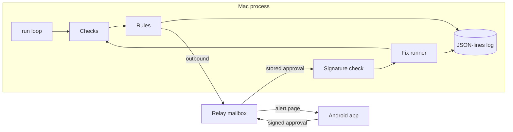

# Daemon Doctor

Watches the apps and background services on a Mac, spots when one is down, stuck, or using the machine, explains it in plain English, and fixes it only after you approve. Fixed rules only: no AI in the decision or fix path.

**Status:** Phase 4 is in the tree. See [docs/plan.md](docs/plan.md) for the full plan.

## Problem

An always-on Mac running helper apps can fail quietly. A process can still be running after it has stopped making progress, or one process can sit on the CPU or memory. Daemon Doctor checks on a timer, writes a local log, and says what it found in plain English.

## Who it's for

Someone who keeps helper apps running on a Mac and wants a local notice when one of them is down, stuck, or holding the machine, with fixes limited to an allowlist in that app's plug-in file. A paired phone can approve one of those fixes. The Mac checks the signature itself.

## Demo

_TBD (demo GIF)._

The Android app starts in demo mode with fictional alerts and does not call a relay. A GIF of that screen is not in the repo.

## Live demo or replay

_TBD (scripted replay)._

## Architecture

The Mac checks on a timer and only opens outbound connections. `relay/` is a Cloudflare Worker that stores alerts, approvals, and results for one Mac id. It uses a SQLite Durable Object as the mailbox. That is the Durable Object backend covered by the Workers free plan. The worker does not check signatures and it has no route that runs a command. It is not deployed. The Mac push hook is an interface with a no-network stub and no keys.

`android/` is a Kotlin and Jetpack Compose app. It pairs by reading the Mac's QR payload with CameraX and the on-device ML Kit barcode scanner, or by pasting that text when there is no camera. It generates an Ed25519 key in the Android Keystore when that algorithm is available, and otherwise keeps a 32-byte seed in the app's private files. It registers the public key with the relay. Alerts, a status row per service, and alert history are on screen. Fix it, Stop, Ignore, and Details use the allowlist the Mac already offered. Fix it prefers `restart`, then `force-restart`. Stop is offered only when the alert includes `stop`. Ignore stays on the phone. A signed approval is posted only when demo mode is off. The signed text matches the Mac verifier: `daemon-doctor/approval/v1`, then `mac_id`, `alert_id`, `fix_id`, `nonce`, and `expires_unix`. `testdata/approval-vectors.json` holds one fixture produced by Go and one produced by the JDK. Go re-signs its own fixture and only verifies the JDK fixture. The Kotlin tests re-sign both.

Firebase Cloud Messaging is behind `PushHub`. The app polls the mailbox every 15 seconds while the process is running. That interval is the value in the app. `google-services.json` is gitignored. `android/google-services.json.example` is a placeholder. The debug APK builds without that file. Demo mode is the default and uses fictional alerts, so the APK does not need a relay.



Plug-ins are YAML or TOML files. A service plug-in names a process, lists checks cheapest first, stores plain-English messages, and approves `stop`, `restart`, or `force-restart`. `plugins/this-mac.yaml` is the host plug-in: sleep or wake, network, free disk space, memory pressure, and CPU. It does not name a process and it has no fixes. The other shipped plug-ins are a generic AI desktop app, Codex, ChatGPT, a local gateway, Proton Mail Bridge, Syncthing, Screen Sharing, and the fictional `example-desktop-app`. Process names are the `process.match` field in each file.

Checks read processes, established outbound TCP connections, and host readings through a `Source` interface. Tests pass an in-memory source. On Linux the live source reads `/proc` and `df -P /`. On macOS it reads `ps`, `lsof`, `route`, `df`, `sysctl` or `memory_pressure`, and `pmset -g log`. A failed host command leaves that reading unknown. Unknown sleep or network does not raise an alert and does not pause anything.

Rules:

- **Down:** the process is missing on 2 checks in a row. The alert offers `restart` when that action is approved.
- **Running but stuck:** the process is up, and a health check has failed. The built-in health check counts established outbound TCP connections in the process tree and fails when that count stays at zero for N checks in a row. The alert offers `force-restart` when that action is approved.
- **Sleep or wake:** a transition raises one alert. The first awake sample does not. While the Mac is asleep, service checks are skipped.
- **Network down:** no IPv4 default route. Other alerts pause. When the route returns, every plug-in is checked again and one summary is sent. The summary counts every loaded plug-in, including This Mac.
- **Low disk:** free space below `min_free_percent`. The shipped file uses 10. Exactly that percent does not alert. No fix is offered.
- **CPU and memory:** a share of the machine at or above the threshold, or memory pressure at or above the configured level, for the configured duration. Both default to 5 minutes when a file omits the duration, and CPU defaults to 85 when a file omits the percent. The shipped file sets 85 and 5m. A sample under the line resets the window. The alert names the highest CPU process, or the largest memory user. A watched service is offered `stop` and `restart` only when those actions are on its allowlist. Any other process is offered `stop` only. A hog does not count toward keeps-happening.
- The same condition does not raise a second alert.
- **Keeps happening:** 3 new failures for one service inside 1 hour. The alert stops offering a fix.

`stop` and `restart` send TERM. `force-restart` sends KILL. `stop` never launches a program. An optional launcher path on `restart` or `force-restart` is executed directly, with no shell and no arguments. `--dry-run` skips both and still rechecks. A real fix on this machine asks for `y` in the terminal unless `--yes` is set. `fix --approval` reads a signed approval file. The signature is the approval. `--yes` does not skip that check. PID 1, this process, and its parent are never signalled. `fix --process` accepts only `stop`, and only for the process named by the latest unwatched CPU or memory alert in the local log.

`daemon-doctor pair` creates an Ed25519 keypair in the state directory (mode 0600) and prints a one-time pairing payload plus a terminal QR. The payload is `daemon-doctor:1`, the Mac id, the Mac public key, a one-time code, and the relay URL when one is set. The private key is not in the payload. With no `relay_url`, pair saves the code and exits. With a relay URL, it polls until a phone posts its public key or the code expires (10 minutes). `pair --list` prints the fingerprint of each paired phone key, the first 8 bytes of SHA-256 as hex.

An approval is signed by a paired phone key. The signed text is the Mac id, alert id, fix id, a one-time nonce, and an expiry. The Mac accepts it only when the signature matches a paired key, the alert is one this Mac recorded, the fix id is one that alert offered, the expiry is still ahead and no further ahead than 10 minutes plus 1 minute of clock skew, and the nonce has not been used. A second use is refused. Unknown JSON fields are refused, so a command cannot ride along in the message. The fix that runs is the one stored with the alert.

Checks, alerts, and fixes are appended to a local JSON-lines file. Values that look like tokens, passwords, or private keys are replaced with `[blanked]`.

```
go build -o daemon-doctor ./cmd/daemon-doctor
daemon-doctor status --config config.example.yaml
daemon-doctor run --config config.example.yaml
daemon-doctor pair --config config.example.yaml
daemon-doctor fix --service example-desktop-app --action force-restart --dry-run --config config.example.yaml
daemon-doctor fix --process ExampleTool --action stop --dry-run --config config.example.yaml
daemon-doctor fix --approval approval.json --dry-run --config config.example.yaml
```

`config.example.yaml` is a placeholder. `relay_url` is left unset there, so those commands stay local. The real config belongs in `~/.config/daemon-doctor/config.yaml` and is gitignored. `launchd/com.example.daemon-doctor.plist` and `launchd/com.example.local-gateway.plist` are example LaunchAgents with placeholder paths. Load them as the normal user.

Relay tests use Miniflare through Vitest. `relay/wrangler.toml` is a placeholder with no account id and no API token.

## Test results

Measured on Linux with Go 1.25.14 (`go version go1.25.14 linux/amd64`).

`go test -count=1 ./...`:

```
?   	github.com/ZeroCool0388/daemon-doctor/cmd/daemon-doctor	[no test files]
ok  	github.com/ZeroCool0388/daemon-doctor/internal/checks	0.009s
ok  	github.com/ZeroCool0388/daemon-doctor/internal/cli	0.094s
ok  	github.com/ZeroCool0388/daemon-doctor/internal/config	0.004s
ok  	github.com/ZeroCool0388/daemon-doctor/internal/doctor	0.135s
ok  	github.com/ZeroCool0388/daemon-doctor/internal/fixes	0.014s
ok  	github.com/ZeroCool0388/daemon-doctor/internal/logbook	0.013s
ok  	github.com/ZeroCool0388/daemon-doctor/internal/plugins	0.003s
?   	github.com/ZeroCool0388/daemon-doctor/internal/push	[no test files]
ok  	github.com/ZeroCool0388/daemon-doctor/internal/relay	0.004s
ok  	github.com/ZeroCool0388/daemon-doctor/internal/rules	0.002s
ok  	github.com/ZeroCool0388/daemon-doctor/internal/security	0.006s
ok  	github.com/ZeroCool0388/daemon-doctor/internal/sysprobe	0.016s
```

A following `go test -count=1 -json ./...` emitted 109 pass events that include a test name. 26 of those names are subtests. The package times above are from the first command. They are not a latency target.

A separate `npm test` in `relay/` (Vitest 4.1.11) reported 8 passed tests. Vitest printed a duration of 1.27s for that run. That figure is the test runner's own total, not a relay latency.

On the same machine, with the Gradle daemon already running and dependencies already downloaded, `./gradlew :core:test :app:testDebugUnitTest :app:assembleDebug --rerun-tasks` in `android/` printed `BUILD SUCCESSFUL in 7s`. The shell `time` for that command was 7.426s real. JUnit XML from that run lists 10 tests, 0 failures, 0 errors, and 0 skipped: 9 in `:core` and 1 in `:app`. The debug APK at `android/app/build/outputs/apk/debug/app-debug.apk` was 36826116 bytes. Camera scanning and the Android Keystore were not run on a device.

## Cost and latency

Not measured.

The worker is not deployed, and the Mac push hook does not call a network. Failure-to-alert time and tap-to-fixed time are not measured. The program's own CPU and memory use is not measured. The phone checks the mailbox every 15 seconds while its process is running. That number is the interval written in the app.

## Limits and next steps

- Linux live checks do not report sleep. The process is running, and this build has no separate sleep signal there. macOS sleep comes from `pmset -g log`.
- Linux memory pressure is `MemAvailable` divided by `MemTotal`: at least 20% available is normal, at least 10% is warning, and below that is critical. macOS uses `kern.memorystatus_vm_pressure_level` when `sysctl` returns it.
- Linux CPU percentages need two samples. The first sample has no percentage. The figure is that process's tick delta divided by the machine tick delta, capped at 100.
- The network check looks for an IPv4 default route. It does not store the gateway address.
- The stuck health signal shipped here is an established outbound TCP count. Another signal can be registered behind the same check interface.
- Consecutive-check state lives in the `run` process. `status` is one sample, so a single `status` call does not by itself raise a Down alert or a 5-minute resource alert.
- After 3 failures in an hour the alert stops offering a fix. `daemon-doctor fix` still runs an allowlisted action when you ask it to.
- A local `y` still approves a fix typed on this machine. A phone approval is a separate signed message.
- The relay sees the one-time pairing code when the phone registers. A hostile relay can substitute a phone key on that first registration. After a key is stored, the Mac rejects forged, replayed, expired, altered, and unknown-key approvals without running a fix.
- Alert text is not encrypted. The mailbox can read the short alert it stores.
- The phone keeps its paired Mac id in app-private preferences. The one-time pairing code is stored with that payload. The private key is not.
- Camera scanning and Android Keystore signing were not run on a device. The unit tests use the software signer. `selectBackend` chooses the keystore path only when Ed25519 key generation succeeds; any failure uses the app-private seed.
- Without `google-services.json`, Firebase is not configured and the app relies on polling while its process is running. A push does not arrive in that build.
- The Mac's scripted demo mode is not built. The GIF is not recorded. The Android demo mode is covered by JVM unit tests. This environment did not open the screens on a device.

Next is the Mac demo mode and a recorded GIF.

## License

MIT. See [LICENSE](LICENSE).
