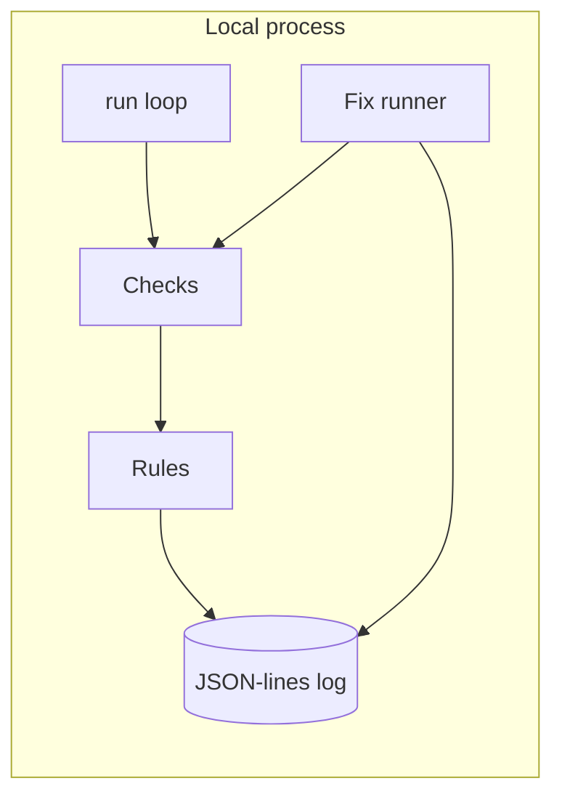

# Daemon Doctor

Watches the apps and background services on a Mac, spots when one is down or stuck, explains it in plain English, and fixes it only after you approve. Fixed rules only: no AI in the decision or fix path.

**Status:** Phase 1 is in the tree. See [docs/plan.md](docs/plan.md) for the full plan.

## Problem

An always-on Mac running helper apps can fail quietly. A process can still be running after it has stopped making progress. Daemon Doctor checks on a timer, writes a local log, and says what it found in plain English.

## Who it's for

Someone who keeps helper apps running on a Mac and wants a local notice when one of them is down or stuck, with fixes limited to an allowlist in that app's plug-in file.

## Demo

_TBD (demo GIF)._

## Live demo or replay

_TBD (scripted replay)._

## Architecture

Phase 1 stays on the machine. There is no phone app and no relay.



Plug-ins are YAML or TOML files. Each one names a process, lists checks cheapest first, stores plain-English messages, and approves `restart` or `force-restart`. The example plug-in is `plugins/example-desktop-app.yaml`, for a fictional app.

Checks read processes and established outbound TCP connections through a `Source` interface. Tests pass an in-memory source. On Linux the live source reads `/proc`. On macOS it reads `ps` and `lsof`.

Rules:

- **Down:** the process is missing on 2 checks in a row. The alert offers `restart` when that action is approved.
- **Running but stuck:** the process is up, and a health check has failed. The built-in health check counts established outbound TCP connections in the process tree (for example port 443) and fails when that count stays at zero for N checks in a row. The alert offers `force-restart` when that action is approved.
- The same condition does not raise a second alert.
- **Keeps happening:** 3 new failures for one service inside 1 hour. The alert stops offering a fix.

`restart` sends TERM. `force-restart` sends KILL. An optional launcher path in the plug-in is executed directly, with no shell and no arguments. `--dry-run` skips both and still rechecks. A real fix asks for `y` in the terminal unless `--yes` is set. PID 1, this process, and its parent are never signalled.

Checks, alerts, and fixes are appended to a local JSON-lines file. Values that look like tokens, passwords, or private keys are replaced with `[blanked]`.

```
go build -o daemon-doctor ./cmd/daemon-doctor
daemon-doctor status --config config.example.yaml
daemon-doctor run --config config.example.yaml
daemon-doctor fix --service example-desktop-app --action force-restart --dry-run --config config.example.yaml
```

`config.example.yaml` is a placeholder. The real config belongs in `~/.config/daemon-doctor/config.yaml` and is gitignored. `launchd/com.example.daemon-doctor.plist` is an example LaunchAgent with placeholder paths. Load it as the normal user.

## Test results

Measured on Linux with Go 1.25.14 (`go version go1.25.14 linux/amd64`).

`go test -count=1 ./...`:

```
?   	github.com/ZeroCool0388/daemon-doctor/cmd/daemon-doctor	[no test files]
ok  	github.com/ZeroCool0388/daemon-doctor/internal/checks	0.003s
ok  	github.com/ZeroCool0388/daemon-doctor/internal/cli	0.040s
ok  	github.com/ZeroCool0388/daemon-doctor/internal/config	0.005s
ok  	github.com/ZeroCool0388/daemon-doctor/internal/doctor	0.025s
ok  	github.com/ZeroCool0388/daemon-doctor/internal/fixes	0.015s
ok  	github.com/ZeroCool0388/daemon-doctor/internal/logbook	0.006s
ok  	github.com/ZeroCool0388/daemon-doctor/internal/plugins	0.003s
ok  	github.com/ZeroCool0388/daemon-doctor/internal/rules	0.002s
ok  	github.com/ZeroCool0388/daemon-doctor/internal/sysprobe	0.006s
```

A following `go test -count=1 -json ./...` emitted 43 pass events that include a test name. 6 of those names are subtests. The package times above are from the first command. They are not a latency target.

## Cost and latency

Not measured.

Phase 1 does not call a network service. Failure-to-alert time and tap-to-fixed time are not measured, because there is no phone notification path. The program's own CPU and memory use is not measured.

## Limits and next steps

- Alerts in this phase are Down and Running-but-stuck. Sleep, network loss, memory pressure, and CPU use are not checked.
- The stuck health signal shipped here is an established outbound TCP count. Another signal can be registered behind the same check interface.
- Consecutive-check state lives in the `run` process. `status` is one sample, so a single `status` call does not by itself raise a Down alert.
- After 3 failures in an hour the alert stops offering a fix. `daemon-doctor fix` still runs an allowlisted action when you ask it to.
- There is no signed phone approval yet. Approval in this phase is a `y` in the terminal.
- Demo mode, the relay, and the Android app are not built.

Next is the rest of the plan: more plug-ins, resource alerts, network hold-back, then the relay and phone app.

## License

MIT. See [LICENSE](LICENSE).
