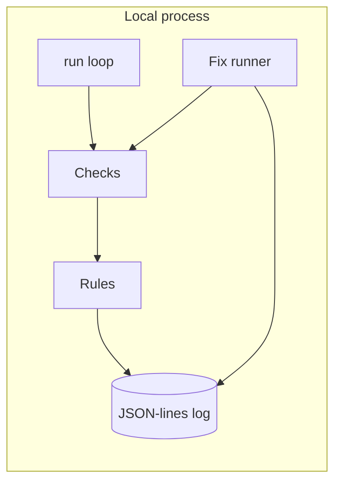

# Daemon Doctor

Watches the apps and background services on a Mac, spots when one is down, stuck, or using the machine, explains it in plain English, and fixes it only after you approve. Fixed rules only: no AI in the decision or fix path.

**Status:** Phase 2 is in the tree. See [docs/plan.md](docs/plan.md) for the full plan.

## Problem

An always-on Mac running helper apps can fail quietly. A process can still be running after it has stopped making progress, or one process can sit on the CPU or memory. Daemon Doctor checks on a timer, writes a local log, and says what it found in plain English.

## Who it's for

Someone who keeps helper apps running on a Mac and wants a local notice when one of them is down, stuck, or holding the machine, with fixes limited to an allowlist in that app's plug-in file.

## Demo

_TBD (demo GIF)._

## Live demo or replay

_TBD (scripted replay)._

## Architecture

Phase 2 stays on the machine. There is no phone app and no relay.



Plug-ins are YAML or TOML files. A service plug-in names a process, lists checks cheapest first, stores plain-English messages, and approves `stop`, `restart`, or `force-restart`. `plugins/this-mac.yaml` is the host plug-in: sleep or wake, network, free disk space, memory pressure, and CPU. It does not name a process and it has no fixes. The other shipped plug-ins are a generic AI desktop app, Codex, ChatGPT, a local gateway, Proton Mail Bridge, Syncthing, Screen Sharing, and the fictional `example-desktop-app`. Process names are the `process.match` field in each file.

Checks read processes, established outbound TCP connections, and host readings through a `Source` interface. Tests pass an in-memory source. On Linux the live source reads `/proc` and `df -P /`. On macOS it reads `ps`, `lsof`, `route`, `df`, `sysctl` or `memory_pressure`, and `pmset -g log`. A failed host command leaves that reading unknown. Unknown sleep or network does not raise an alert and does not pause anything.

Rules:

- **Down:** the process is missing on 2 checks in a row. The alert offers `restart` when that action is approved.
- **Running but stuck:** the process is up, and a health check has failed. The built-in health check counts established outbound TCP connections in the process tree and fails when that count stays at zero for N checks in a row. The alert offers `force-restart` when that action is approved.
- **Sleep or wake:** a transition raises one alert. The first awake sample does not. While the Mac is asleep, service checks are skipped.
- **Network down:** no IPv4 default route. Other alerts pause. When the route returns, every plug-in is checked again and one summary is sent. The summary counts every loaded plug-in, including This Mac.
- **Low disk:** free space below `min_free_percent`. The shipped file uses 10. Exactly that percent does not alert. No fix is offered.
- **CPU and memory:** a share of the machine at or above the threshold, or memory pressure at or above the configured level, for the configured duration. Both default to 5 minutes when a file omits the duration, and CPU defaults to 85 when a file omits the percent. The shipped file sets 85 and 5m. A sample under the line resets the window. The alert names the highest CPU process, or the largest memory user. A watched service is offered `stop` and `restart` only when those actions are on its allowlist. Any other process is offered `stop` only. A hog does not count toward keeps-happening.
- The same condition does not raise a second alert.
- **Keeps happening:** 3 new failures for one service inside 1 hour. The alert stops offering a fix.

`stop` and `restart` send TERM. `force-restart` sends KILL. `stop` never launches a program. An optional launcher path on `restart` or `force-restart` is executed directly, with no shell and no arguments. `--dry-run` skips both and still rechecks. A real fix asks for `y` in the terminal unless `--yes` is set. PID 1, this process, and its parent are never signalled. `fix --process` accepts only `stop`, and only for the process named by the latest unwatched CPU or memory alert in the local log.

Checks, alerts, and fixes are appended to a local JSON-lines file. Values that look like tokens, passwords, or private keys are replaced with `[blanked]`.

```
go build -o daemon-doctor ./cmd/daemon-doctor
daemon-doctor status --config config.example.yaml
daemon-doctor run --config config.example.yaml
daemon-doctor fix --service example-desktop-app --action force-restart --dry-run --config config.example.yaml
daemon-doctor fix --process ExampleTool --action stop --dry-run --config config.example.yaml
```

`config.example.yaml` is a placeholder. The real config belongs in `~/.config/daemon-doctor/config.yaml` and is gitignored. `launchd/com.example.daemon-doctor.plist` and `launchd/com.example.local-gateway.plist` are example LaunchAgents with placeholder paths. Load them as the normal user.

## Test results

Measured on Linux with Go 1.25.14 (`go version go1.25.14 linux/amd64`).

`go test -count=1 ./...`:

```
?   	github.com/ZeroCool0388/daemon-doctor/cmd/daemon-doctor	[no test files]
ok  	github.com/ZeroCool0388/daemon-doctor/internal/checks	0.002s
ok  	github.com/ZeroCool0388/daemon-doctor/internal/cli	0.051s
ok  	github.com/ZeroCool0388/daemon-doctor/internal/config	0.002s
ok  	github.com/ZeroCool0388/daemon-doctor/internal/doctor	0.012s
ok  	github.com/ZeroCool0388/daemon-doctor/internal/fixes	0.014s
ok  	github.com/ZeroCool0388/daemon-doctor/internal/logbook	0.009s
ok  	github.com/ZeroCool0388/daemon-doctor/internal/plugins	0.003s
ok  	github.com/ZeroCool0388/daemon-doctor/internal/rules	0.002s
ok  	github.com/ZeroCool0388/daemon-doctor/internal/sysprobe	0.011s
```

A following `go test -count=1 -json ./...` emitted 75 pass events that include a test name. 6 of those names are subtests. The package times above are from the first command. They are not a latency target.

## Cost and latency

Not measured.

This phase does not call a network service. Failure-to-alert time and tap-to-fixed time are not measured, because there is no phone notification path. The program's own CPU and memory use is not measured.

## Limits and next steps

- Linux live checks do not report sleep. The process is running, and this build has no separate sleep signal there. macOS sleep comes from `pmset -g log`.
- Linux memory pressure is `MemAvailable` divided by `MemTotal`: at least 20% available is normal, at least 10% is warning, and below that is critical. macOS uses `kern.memorystatus_vm_pressure_level` when `sysctl` returns it.
- Linux CPU percentages need two samples. The first sample has no percentage. The figure is that process's tick delta divided by the machine tick delta, capped at 100.
- The network check looks for an IPv4 default route. It does not store the gateway address.
- The stuck health signal shipped here is an established outbound TCP count. Another signal can be registered behind the same check interface.
- Consecutive-check state lives in the `run` process. `status` is one sample, so a single `status` call does not by itself raise a Down alert or a 5-minute resource alert.
- After 3 failures in an hour the alert stops offering a fix. `daemon-doctor fix` still runs an allowlisted action when you ask it to.
- There is no signed phone approval yet. Approval in this phase is a `y` in the terminal.
- Demo mode, the relay, and the Android app are not built.

Next is the relay and phone app, then demo mode.

## License

MIT. See [LICENSE](LICENSE).
