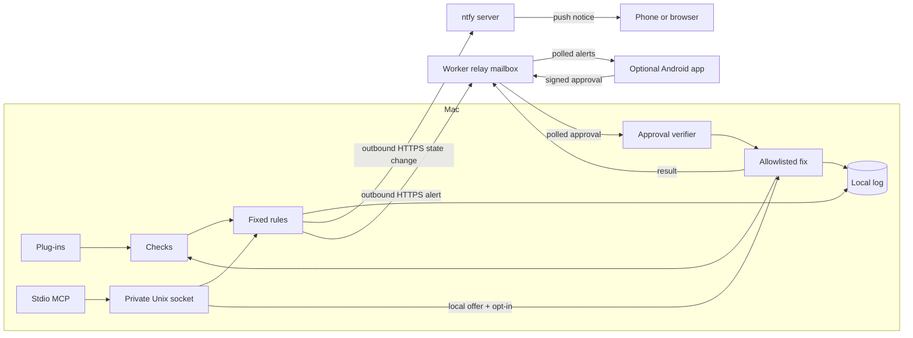

# Daemon Doctor

[](https://github.com/ZeroCool0388/daemon-doctor/actions/workflows/ci.yml)

**A small watchdog for the apps and background services on your Mac.** It detects failures, explains them in plain English, and runs a locally allowlisted fix after a signed phone approval or local confirmation. Local MCP tools let an LLM client inspect health and request a configured fix.

Fixed rules, one Go binary, one plug-in file per service. The Mac runs as the normal user and connects outward to ntfy for phone alerts
and to an optional relay mailbox; it opens no inbound ports.

## The problem

A helper app can still be running after it stops making progress. A sync tool, mail bridge or scheduled job can fail quietly. Daemon Doctor checks processes, connections, file ages and host readings, then offers the action configured for that service.

## Who it's for

People who keep background services running on a Mac and want phone alerts, explicit approval before a fix, and a local record of what happened.

## Demo

The [terminal recording](docs/demo.cast) shows `daemon-doctor demo`. Play it with `asciinema play docs/demo.cast`, or run the replay from a checkout:

```sh
go build -o daemon-doctor ./cmd/daemon-doctor
./daemon-doctor demo
```

Its first scene includes:

```text
Scene 1. Example Desktop App is stuck, then force-restarted.
12:04 UTC  alert: Example Desktop App is open but has no established outbound connection on port 443, so it looks stuck.
12:04 UTC  fix offered: force-restart
12:04 UTC  outcome: Fixed. Example Desktop App looks healthy on recheck.
```

The replay also covers network recovery, an unwatched CPU hog and repeated failures. It uses fictional services and a scripted clock, with no accounts, keys, config or network. The Android app also starts in demo mode.

## Phone alerts

**ntfy is the recommended phone alert.** Enable it with
`daemon-doctor ntfy-setup`, then subscribe to the printed link in the
[ntfy phone app](https://docs.ntfy.sh/subscribe/phone/) or browser. It sends a
short notice when a watched service becomes Down or Stuck and one when it
recovers. An unchanged condition produces no repeated notices.

ntfy runs independently of the relay and phone pairing. The Daemon Doctor
Android app remains an optional extra for service views and signed fix approvals.

## Use with Cursor, Codex or Claude

`daemon-doctor mcp` exposes service health, check details, recent events and
current fix offers through the running daemon's private local socket. Live
fixes are disabled by default. `daemon-doctor mcp --demo` lets you try all
five tools against scripted fake incidents without config or network.

See [setup examples and approval requirements](docs/mcp.md) for each client.
MCP destructive annotations cannot enforce human approval: live fixes need
both daemon and MCP opt-in, plus a client configured to confirm each call.

## Remote MCP

A cloud MCP client can connect through the same Cloudflare relay. The Mac
keeps an authenticated outbound WebSocket; it needs no inbound port or phone
pairing. Remote calls use the same five MCP tools and fix handlers as stdio.

Enable the link in the Mac config, then run the daemon:

```yaml
relay:
  url: https://your-relay.example.workers.dev
  mcp_link: true
control:
  allow_fixes: false
```

```sh
daemon-doctor mcp-token --config ~/.config/daemon-doctor/config.yaml
daemon-doctor run --config ~/.config/daemon-doctor/config.yaml
```

`mcp-token` creates the Mac identity if needed, registers a new token's SHA-256
hash with the relay and prints the token once. It does not save the token.
The command writes the Streamable HTTP URL to stderr. Use that URL and the
printed token in the client:

```text
https://your-relay.example.workers.dev/v1/macs/<mac_id>/mcp
Authorization: Bearer <token>
```

The endpoint accepts JSON-RPC over POST and returns JSON. It supports
`initialize`, `notifications/initialized`, `ping`, `tools/list` and
`tools/call`; GET returns 405. A supplied `Mcp-Session-Id` is echoed, but
requests are sessionless. The client's MCP protocol version and standard MCP
headers are forwarded to the Mac. Requests and link responses are bounded
to 64 KiB.
The daemon sends a heartbeat every 30 seconds and reconnects with backoff.
Calls wait up to 15 seconds; an offline or unresponsive Mac returns
`Mac unreachable, last seen <ISO time>` (or `never` before the first link).
For `tools/call`, this is a tool result with `isError: true`.

**The token is a full-access credential to read status and request allowlisted
fixes.** Keep it private and use HTTPS. Rotate it by running `mcp-token`
again; the previous token stops authorising new requests. Remote live fixes
require `control.allow_fixes: true` and a client that asks for explicit human
approval for each exact offer. Tool annotations do not enforce that approval.
Single-use offers, the allowlist, fresh checks and repeated-failure lockout
remain enforced by the Mac. Backend calls use the link request deadline,
including time spent waiting for daemon state locks. Cancellation stops further fix steps; signals already sent
cannot be undone. Inspect status and recent events after a timeout.

The Mac stores its separate link secret in `mcp-link.secret` with mode 0600;
the relay stores credential hashes and the Mac public key. Link registration
requires an Ed25519 signature from the Mac's existing identity key, binding the
remote endpoint id and link-secret hash. The remote id derives from that public
key; the phone-pairing id stays unchanged. Subsequent registrations also require
the existing link secret. Hash-only registrations from older versions are
refused; run `mcp-token` again and update the client's URL and token.
The relay authenticates access but can read requests and results; it remains
a trusted component for remote MCP and can forward fix requests. Phone pairing
secrets and signed phone approvals remain separate.

`relay.mcp_link` defaults to false. The link uses the existing SQLite-backed
Durable Object with WebSocket hibernation and no additional hosted service.
Worker and Durable Object free-tier quotas still apply.

## Architecture



- **Mac:** checks on the configured interval, logs locally with secret-looking values blanked, and polls for pairing messages and approvals every five seconds as well as after check cycles.
- **Relay:** a Cloudflare Worker with a SQLite-backed Durable Object per Mac id. It stores `pairing`, `alerts`, `approvals` and `results`; pages are capped at 100 records. It does not verify approvals or run commands.
- **ntfy:** recommended for phone alerts. The daemon makes one bounded delivery attempt per confirmed Down, Stuck or recovery transition. Sending runs separately from monitoring; the topic stays in the local config.
- **Android (optional):** shows alerts, service status and history, and signs approvals. It polls every 15 seconds while its process runs. The relay's push delivery is still a stub.

### Plug-ins and fixes

A plug-in selects a process or scheduled job, lists checks cheapest first, and defines allowed actions. For example:

```yaml
id: example-sync
name: Example Sync
process:
  match: example-sync
checks:
  - type: process_running
fixes:
  stop:
    kind: stop
  restart:
    kind: restart
    launcher: /opt/example-sync/bin/example-sync
    args: ["--config", "/opt/example-sync/config.xml"]
  force-restart:
    kind: force-restart
    launcher: /opt/example-sync/bin/example-sync
    args: ["--config", "/opt/example-sync/config.xml"]
```

Replace the example paths with the executable and arguments for your service. `restart` sends TERM and `force-restart` sends KILL to the matched process and its children, children first. **Both actions need a `launcher` setting to relaunch the service.** Without it, they only signal the processes and re-check. The launcher is an absolute executable path, run directly with the fixed `args` from the plug-in, without a shell. `stop` never launches anything. For a launchd-managed service, `launchctl_kickstart` takes a `label` instead of a launcher.

The supplied plug-ins are starting points: configure launchers before relying on their restart actions. Process selection also supports command-line substrings and regular expressions; checks include outbound TCP connections, required flags, recent files and launchd job results.

### Alerts

| Condition | Behaviour |
|---|---|
| Down | Two consecutive missing-process checks; offers an approved restart or launchd kickstart. |
| Running but stuck | A failing health signal; offers an approved force restart. |
| Missing flags or failed scheduled job | Offers the configured restart or kickstart. |
| CPU or memory pressure | Sustained resource use names the culprit. An unwatched process can only be stopped. |
| Network down or sleep | Service checks pause; network recovery produces a summary. |
| Low disk | Reports the condition without offering a fix. |
| Repeated failures | Three incidents in an hour stop new fix offers. |

Thresholds live in the plug-in files. Fixes are re-checked and logged locally. The signed-approval path also attempts to post outcomes to the relay's `results` mailbox when a relay is configured; ordinary local CLI fixes report outcomes in the terminal and local log.

### Pairing and approval trust

First pairing trusts the version 2 QR shown by the local Mac and the phone that receives it. The QR contains the Mac id, Mac public key, relay URL and a random one-time secret. Keep the QR, PNG and pasted payload private: anyone holding that secret during its ten-minute validity window can register a key.

The phone sends its public key, a pairing id (SHA-256 of the secret), and an HMAC-SHA256 proof. The proof binds the Mac id, Mac public key, pairing id and phone public key. **The QR secret never goes through the relay.** The Mac checks the proof and local expiry before storing the key, so the relay cannot substitute its own key without knowing the secret. The secret registers one key; delivery of that same registration can be repeated safely.

Phone-approved fixes need an Ed25519 approval signed by a paired phone. Local fixes accept terminal confirmation or `--yes` without a phone signature. For a phone approval, the Mac checks that:

1. the signature matches a trusted phone key and the approval names this Mac;
2. the alert was raised locally and offered that exact fix;
3. the expiry is in the future and within ten minutes, plus one minute of clock skew;
4. the nonce has not been used, including by another process sharing the state directory.

Nonce consumption is locked across processes and synced before the fix runs. Extra approval fields are refused. The relay can read alert text and delay, drop or replay messages, but cannot forge a pairing proof or a valid approval without the relevant secret or phone key. This assumes the Mac, phone and their local key storage remain trusted.

Version 1 pairing payloads and registrations are refused. Old `phones.json` is preserved but no longer trusted; upgrade the Mac and Android app and pair again to store authenticated keys in `phones-v2.json`.

## Quick start

Build the Mac program with Go 1.25 or later. Relay deployment uses Node 22 and a Cloudflare account. Android builds use Java 17 and the Android SDK; a prebuilt debug APK is also available through the workflow described below.

### 1. Set up the Mac

```sh
go build -o daemon-doctor ./cmd/daemon-doctor
mkdir -p ~/bin ~/.config/daemon-doctor/plugins
cp daemon-doctor ~/bin/
cp config.example.yaml ~/.config/daemon-doctor/config.yaml
cp plugins/this-mac.yaml plugins/syncthing.yaml ~/.config/daemon-doctor/plugins/
~/bin/daemon-doctor status
```

Copy only plug-ins for services you run, and configure their fixes. `plugins_dir` is resolved relative to the config file. Keep the real config and keys outside the checkout.

### 2. Set up ntfy phone alerts

Keep the config outside a Git checkout, then run:

```sh
~/bin/daemon-doctor ntfy-setup
```

Use `--config path` for a different local YAML or TOML config. The command
creates a 256-bit random topic, enables notifications, saves the config with
mode 0600 and prints the subscribe link. Subscribe to that link in ntfy, then
run the daemon. Setup itself sends no notification.

The local config block is `notify.ntfy`, with `server`, `topic` and `enabled`.
`server` defaults to `https://ntfy.sh`; `enabled` defaults to false. The example
config leaves the topic empty. A self-hosted ntfy server can use its own HTTPS
origin. Running setup again generates a new topic and subscribe link.

Keep the topic and subscribe link private and outside version control. On an
unrestricted ntfy server, knowing the topic permits reading and publishing
notices. The server can read the notification text, including service names.
See [ntfy's publishing and topic guidance](https://docs.ntfy.sh/publish/).

Debouncing lasts for the daemon run. Paused or transitional readings do not
produce recovery notices; recovery requires a healthy sample. Failed deliveries
are logged without the topic and are not retried on every unchanged sample.
The delivery queue and HTTP timeout are bounded; successful phone delivery
still depends on the ntfy server, network and subscription settings.

### 3. Deploy the optional relay

From `relay/`:

```sh
npm ci
npx wrangler login
npx wrangler deploy
```

`relay/wrangler.toml` enables `workers_dev`, so Wrangler deploys to your account's workers.dev address without a custom route. `GET /health` returns `{"ok":true}`:

```sh
curl https://your-relay.example.workers.dev/health
```

Set the deployed origin in the local config, using the placeholder below as an example:

```yaml
relay:
  url: https://your-relay.example.workers.dev
```

Use an origin without a path, query or credentials. Leave `relay.url` unset when using ntfy alone. The relay supports the optional
Android app and remote MCP.

### 4. Install the optional Android app

The [Android APK workflow](.github/workflows/android-apk.yml) builds on pushes to `main` and uploads the `daemon-doctor-debug-apk` artifact containing an APK and its `.sha256` file. Pushes of `v*` tags also attach those files to the corresponding [release](https://github.com/ZeroCool0388/daemon-doctor/releases). Download the artifact from a completed [workflow run](https://github.com/ZeroCool0388/daemon-doctor/actions/workflows/android-apk.yml), or use a tagged release asset, and open the APK on your phone to sideload it.

CI builds use fresh debug signing keys. Installing a newer CI build over an older one requires uninstalling the older app first, which removes its saved pairing. To build locally, run `./gradlew :app:assembleDebug` in `android/`; the output is `android/app/build/outputs/apk/debug/app-debug.apk`.

### 5. Pair the optional Android app

```sh
~/bin/daemon-doctor pair --out pairing.png
```

`daemon-doctor pair` prints the QR and payload in the terminal. **`--out pairing.png` also writes a PNG**, with mode 0600, and refuses to overwrite an existing file. Scan either QR from the app's pairing screen, or paste the payload. The Mac prints `paired` and the phone key fingerprint after verifying the proof. `daemon-doctor pair --list` lists trusted fingerprints.

The Mac private key stays in the state directory with mode 0600. The phone uses Android Keystore when Ed25519 is available, otherwise an app-private signing seed.

### 6. Run at login

Replace the binary and config paths in `launchd/com.example.daemon-doctor.plist`, then install it as the normal user:

```sh
cp launchd/com.example.daemon-doctor.plist ~/Library/LaunchAgents/
launchctl bootstrap gui/$(id -u) ~/Library/LaunchAgents/com.example.daemon-doctor.plist
```

For foreground monitoring, run `~/bin/daemon-doctor run`. Local fixes prompt for `y` unless `--yes` is set; `--dry-run` re-checks without signalling or launching anything. `fix --approval approval.json` verifies a signed approval even when `--yes` is supplied.

## Verification

CI runs formatting, Go checks, relay tests and Android unit tests and builds. To run them locally:

```sh
gofmt -l .
go vet ./...
go test ./...
(cd relay && npm ci && npm test)
(cd android && ./gradlew :core:test :app:testDebugUnitTest :app:assembleDebug)
```

The suites cover scripted incidents, hostile-relay messages, shared nonce consumption, pairing proofs and Go/Android signing fixtures.

## Cost and latency

The program and app use free dependencies, and the relay is designed for the Workers free tier. With the example intervals, continuous Mac and Android polling is about 46,080 requests/day before message posts, retries and pairing. Usage determines whether a deployment stays within provider limits. End-to-end failure-to-phone and approval-to-result latency is not established by the demo.

## Limits and next steps

- ntfy provides the recommended push notices. The optional Android app still relies on polling while its process runs; relay push delivery remains a stub.
- The Android app does not display the relay's fix results yet. Use the local log to inspect the action and recheck.
- Alerts are not encrypted end to end. The QR secret and private signing keys stay off the relay.
- Failed deliveries retry in memory and are lost if the Mac process exits. Retry work and request timeouts are bounded to keep monitoring responsive.
- The repository's tests do not establish camera scanning, Keystore support or the complete Mac-to-phone flow on a physical device.

Next: validate ntfy delivery and the optional signed-approval flow on physical
devices, and measure end-to-end latency. An iPhone app comes later.

## License

MIT. See [LICENSE](LICENSE).
