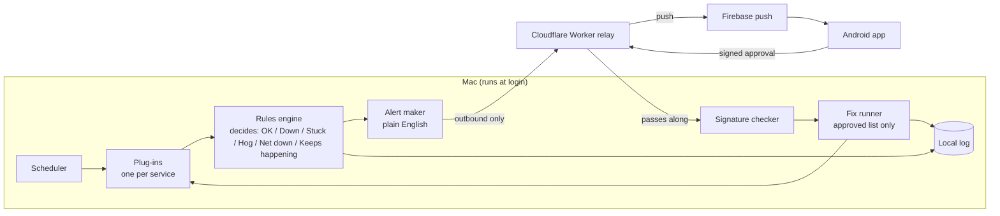

# Daemon Doctor: build plan

_Neutral project plan. All examples are synthetic._

**In one line:** a small program on a Mac that watches the apps and background services you rely on. It notices when one is down, stuck, or hogging the machine, tells your phone in plain English, and fixes it only when you tap "Fix it".

Detection and fixes use fixed rules. Zero running cost.

---

## 1. The problem
An always-on Mac running helper apps (sync tools, mail bridges, desktop apps, scheduled jobs) fails quietly. An app can look open but have lost its link. The Mac never slept, the network was fine, yet the app stopped answering. You only find out hours later, when you need it. Then you have to work out the cause by hand from power logs, process lists and network status.

Daemon Doctor does that checking for you, all the time, and explains what it found.

## 2. Key choices

### Mac program language: **Go**
- Builds one small file with nothing else to install, so it's easy to start at login.
- Simple to read, so others can follow the code in a public repo.
- Good built-in tools for running checks on a timer, web connections and signatures.
- Rust would be slightly leaner, but it's slower to build and harder to review. That's not worth it for a program that mostly waits and runs small checks.

### Relay (the go-between for the Mac and phone): **Cloudflare Worker**
A "Worker" is a tiny program Cloudflare runs for you on its servers.
- The free plan covers this easily: about 100,000 requests a day, and we'd use a few hundred.
- It never goes to sleep. Supabase's free projects pause after a week with no activity, which is the wrong trait for an alert system.
- It stores alerts and approvals in a free Durable Object. The Mac polls the mailbox over HTTPS every five seconds.
- It can send phone pushes through Firebase Cloud Messaging (FCM, Google's free push service).
- The relay is "dumb on purpose". It only passes messages along and can't make the Mac do anything (see the security model).

### Phone: Android app in Kotlin
Installed directly from a file (an "APK", sideloaded), not from the Play Store. It gets pushes through free FCM. iPhone comes later.

---

## 3. How it fits together



- The Mac only ever connects outward, so nothing on the internet can connect into it.
- The phone signs each approval. The Mac checks that signature itself before doing anything.

---

## 4. Plug-ins (one per watched service)
Each service is described in a config file (YAML, a simple text format), not in code. Adding a service means adding a file.

Each plug-in lists:
- **Checks, cheapest first.** For example: is the process running? Then, is its port answering? Then, has its log or heartbeat file updated recently? Then a light test request. Checking stops at the first failure, which keeps the program light.
- **Messages** in plain English for each problem.
- **Approved fixes**, such as "restart via launchctl" or "force close and reopen". These are the only actions allowed.

Example (shortened):
```yaml
id: desktop-app
name: Example Desktop App
process: "/Applications/a desktop app.app/Contents/MacOS/a desktop app"
checks:
  - type: process_running
  - type: launched_with_flags
    flags: [--disable-renderer-backgrounding]
  - type: heartbeat
    source: app_connection_status   # exact signal confirmed in Phase 1
    stale_after: 5m
fixes:
  restart: { kind: quit_and_launch, launcher: "~/bin/desktop-app-launch.sh" }
  force_restart: { kind: kill_and_launch, launcher: "~/bin/desktop-app-launch.sh" }
messages:
  stuck: "A desktop app is open but has stopped answering for {mins} minutes. The Mac and network are fine."
```

**Starter plug-ins:** a desktop app, Codex, a local service gateway (plus its scheduled health job), a mail bridge, Syncthing, Screen Sharing, and "This Mac" (sleep and wake events, network, free disk space, memory pressure).

---

## 5. Alert types and rules

| Alert | When | What's offered |
|---|---|---|
| **Down** | Process not running (2 checks in a row) | Restart |
| **Running but stuck** | Process up, but its link or heartbeat hasn't responded for X minutes | Force close and restart |
| **Hogging the Mac** | High memory pressure or CPU over ~85% for 5+ minutes. Names the culprit | Watched app: Stop or Restart. Unknown app: **Stop only** |
| **Network down** | No route to the internet | No fix. Wait, then re-check every service once it's back, and send one summary |
| **Keeps happening** | 3 failures for one service within an hour | Auto-fix offers stop. "Needs a look" flag with history |

Rules:
- While the network is down, other alerts are held back, so one cause doesn't trigger ten alerts.
- After every fix, it re-checks and reports "Fixed" or "Didn't work".
- Everything (checks, alerts, approvals, fixes, results) goes to a local log file, with anything secret-looking blanked out.

## 6. Example alert texts
- **Down:** "Syncthing has stopped. It's not running. [Fix it: restart] [Ignore] [Details]"
- **Stuck:** "A desktop app is open but hasn't answered for 12 minutes. The Mac didn't sleep and the network is fine, so the app itself has stalled. [Fix it: force restart] [Ignore] [Details]"
- **Hog:** "Docker has used most of the memory for 6 minutes and the Mac is slowing down. [Stop Docker] [Restart Docker] [Ignore]"
- **Unknown hog:** "An app not on your list (ExampleTool) is using 95% CPU for 5 minutes. [Stop it] [Ignore]"
- **Network:** "The Mac lost internet at 21:02. I'll re-check everything when it's back." Later: "Back at 21:09. All 8 services OK."
- **Keeps happening:** "A desktop app has failed 3 times in the last hour. I've stopped offering automatic fixes. Worth a proper look. [Details]"
- **After a fix:** "Fixed. A desktop app is answering again (took 14s)." / "Didn't work. A desktop app is still not answering."

---

## 7. Security model (plain English)
- **Fixed menu only.** The Mac only runs fixes written in its local config. A message can only say "do fix #2 for alert #123". It can never carry a command. Unknown fix: ignored and logged.
- **Pairing by QR code.** The Mac shows a QR code in the terminal or a small web page on the Mac itself. The phone scans it. They swap public keys (a public key lets someone check a signature but not make one). The phone's private key stays locked in Android's secure key storage (Keystore).
- **Signed, single-use approvals.** When you tap "Fix it", the phone signs exactly: this Mac, this alert, this fix, a random one-off number (a "nonce") and an expiry 10 minutes ahead. The Mac checks:
  1. the signature is from the paired phone,
  2. the alert and fix match an alert it actually raised,
  3. it hasn't expired,
  4. the nonce hasn't been used before (no replays).
- **The relay isn't trusted.** Even if someone took over the Cloudflare Worker, they couldn't forge a phone signature, so they couldn't trigger anything. At worst they could block or delay messages. Alerts are kept short and carry no secrets. Optionally they can be encrypted end to end, so the relay can't read them (open question).
- **Outbound only.** The Mac opens the connection out to the relay. There are no open ports on the Mac.
- **Secrets stay local.** Keys and relay and FCM details live in a gitignored local config file (one that's never uploaded). The public repo only has a `config.example.yaml`.
- **Least privilege.** It runs as the normal user, never as root (the all-powerful admin account). Fixes are limited to the user's own apps and services.

---

## 8. One codebase, two modes
- **Real mode:** reads `~/.config/daemon-doctor/config.yaml` (gitignored) with your services, keys, relay URL and FCM details.
- **Demo mode** (`daemon-doctor demo`): fake services and a scripted incident replay. The Mac and network stay healthy, a fake desktop app "stalls", an alert is raised, it's approved, force-restarted and confirmed fixed. Then a fake "keeps happening" sequence. It needs no Mac, accounts or keys, and runs on Linux in CI. The Android app has a matching demo mode with built-in fake alerts.

Relay settings use the local config key `relay.url`:

```yaml
relay:
  url: https://your-relay.example.workers.dev
```

`daemon-doctor pair --out pairing.png` prints a terminal QR and saves the same pairing payload as a PNG. It includes a random Mac id, public key, one-time code, and the configured relay origin. Approvals use the existing signature verifier; only local allowlisted fixes run, followed by a recheck and result post. Failed posts retry in memory while the process runs.

## 9. Repo layout
```
daemon-doctor/
  cmd/daemon-doctor/        main program (run, demo, pair, status)
  internal/
    checks/                 process, port, heartbeat, log-age, launch-flags, http
    rules/                  alert decisions, network hold-back, keeps-happening
    fixes/                  approved-fix runner and re-check
    plugins/                config loader and validator
    relay/                  outbound HTTP mailbox client
    security/               pairing, signature check, nonce store
    logbook/                local log with secret blanking
    mac/                    pmset, memory pressure, CPU, disk, launchctl readers
    demo/                   fake services and scripted incidents
  plugins/                  starter YAML files for desktop apps, local services,
                            mail, sync, screen sharing, and this-mac
  relay-worker/             Cloudflare Worker (TypeScript) and wrangler.toml
  android/                  Kotlin app (Jetpack Compose)
  launchd/                  example LaunchAgent plist
  testdata/                 recorded synthetic traces
  docs/                     architecture, security, demo GIF
  config.example.yaml
  README.md
```

---

## 10. Milestones
Each phase is built as a separate branch and pull request.
After each phase, tests are re-run and GitHub checks must be green before any merge.

1. **Mac core, with a desktop app and stuck detection.** Scheduler, check types, rules engine, local log, CLI `status`, LaunchAgent. An example desktop app plug-in with Down and Stuck detection. Fixes run locally after a "y" in the terminal, for now. Done when replaying a sample incident trace produces the right "stuck, not sleep or network" verdict.
2. **Other plug-ins and resource alerts.** The remaining 8 starter plug-ins, the memory and CPU hog rule with culprit naming, network hold-back and re-check, "keeps happening", and re-check after every fix.
3. **Relay and pairing.** Cloudflare Worker, outbound HTTP polling, terminal and PNG QR pairing, signed single-use approvals with a 10-minute expiry, and nonce store. Done when the security tests pass, including a "malicious relay" test.
4. **Android app.** FCM push, alert cards (Fix it / Stop / Ignore / Details), status screen, alert history, Keystore signing, sideload APK built in CI.
5. **Demo mode and README.** Scripted replays, demo GIF, architecture diagram, test results, measured cost and latency, and the README in the standard order: problem, who it's for, demo GIF, live demo or replay, architecture, test results, cost and latency, limits and next steps. Neutral wording and synthetic data only.

## 11. Test plan
- **Unit tests:** each check type, each rule (thresholds, 2-in-a-row, 5-minute hog window, 3-in-an-hour), and secret blanking in the log.
- **Replay tests:** recorded synthetic traces of Down, Stuck-with-healthy-Mac, Mac-slept, network outage with 8 services, hog by a watched app, hog by an unknown app, and a flapping service. Each expects an exact alert or no alert.
- **Security tests (must all pass):** forged signature, wrong phone, expired approval (11 min), reused nonce, valid signature but a fix not on the list, a fix for a different alert, a command smuggled into a message, and a relay that alters or replays messages. All are refused and logged.
- **Fix tests:** fake services that recover or don't. "Fixed" and "Didn't work" are reported correctly, and auto-fixes are switched off after 3 failures.
- **Resource use:** measure Daemon Doctor's own CPU and memory over 1 hour (target: under 1% CPU, under 30 MB). Report real numbers only.
- **Latency:** measure the time from failure to alert on the phone, and from tap to fixed. Report real measured numbers.
- **Android:** UI tests in demo mode, and the signing happy path plus the expired case.
- **CI:** GitHub Actions runs the Go tests, replays and Worker tests on Linux, and builds the APK. The demo needs no secrets.

## 12. Cost
Go program: free. Cloudflare Worker and Durable Object: free tier. FCM: free. GitHub Actions on a public repo: free. Sideloaded APK: no Play Store fee. **Total: $0 / £0.**

## 13. Out of scope
Dynamic diagnosis. iPhone app (later). Fixing anything not on the approved list. Remote shell of any kind.

## 14. Open questions
1. **The desktop app's "heartbeat" signal.** What's the cheapest reliable sign that its link is alive? Options are a local status endpoint, a recently updated file in its app data, or its network connections (`lsof`). To investigate in Phase 1.
2. Should alert text be end-to-end encrypted so the relay can't read service names? (Small extra work, recommended.)
3. Hog thresholds: is ~85% CPU / high memory pressure for 5 minutes a sensible default?
4. Quiet hours: should non-urgent alerts wait overnight?
5. Should "Ignore" snooze the alert for a set time, such as 1 hour?
6. Should more than one phone be pairable?
7. The public demo GIF: record from the Android demo mode or the terminal demo, or both?
8. What happens if the relay is unreachable for a long time? Fall back to local-only logging and a daily summary when it's back?
